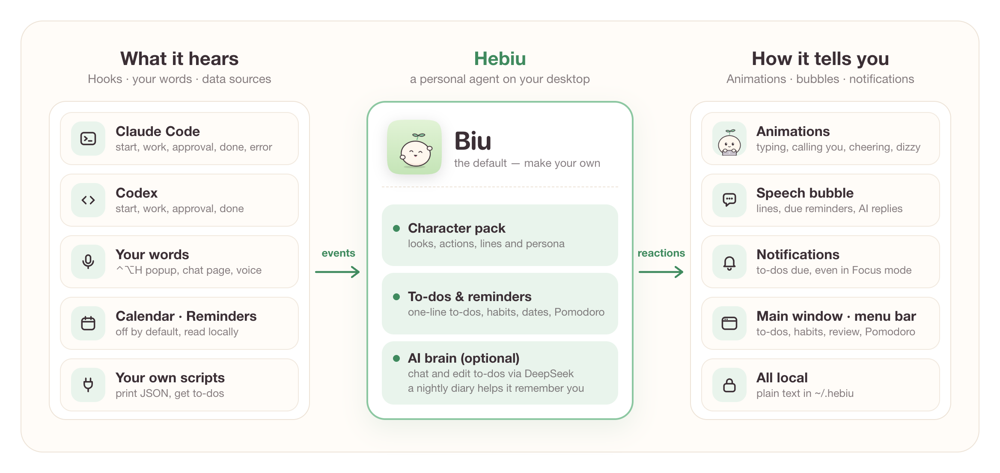
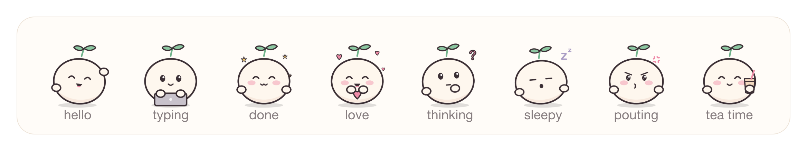

<div align="center">

<picture>
  <source media="(prefers-color-scheme: dark)" srcset="docs/images/logo-dark.png">
  
</picture>

### A personal agent that lives on your Mac desktop

Codes with you · remembers for you · calls you on time · wears any look you like

[](https://github.com/NouKinSG/hebiu/actions/workflows/test.yml) [](LICENSE) [](#quick-start) [](Package.swift) [](#with-claude-code--codex)

[Quick start](#quick-start) · [Make a character](docs/CHARACTERS.md) · [FAQ](#faq) · [Contributing](CONTRIBUTING.md)

</div>

[中文](README.md) | **English**

Hebiu is a little character that lives in the corner of your screen. While Claude Code or Codex works, it types along, calls you when approval is needed and cheers when the job is done. The rest of the day it keeps your to-dos, nudges you on time and reminds you to take a break. Turn on the optional AI brain and it understands plain language, writes a diary every night and slowly gets to know you. Its look, name, personality and every animation are yours to change.

**Native Swift · no network by default · plain-text local data · MIT**

> The UI and the natural-language date parser are Chinese for now. Translations are very welcome.

<p align="center">
  
</p>

## What it does

| | |
|:---:|---|
|  | **Codes with you**<br>Types while Claude Code or Codex works, calls you when approval is needed, cheers when a task finishes, looks dizzy on errors. Keeps several sessions apart and quietly tells you when a background one is done. |
|  | **One-line to-dos, called on time**<br>Write a to-do in one sentence and the time is picked up for you, including repeats. Plus habits, important dates (lunar calendar too), Pomodoro, quick notes, mood and a weekly review. |
|  | **AI brain (optional)**<br>Bring your own DeepSeek key. Chat with it and let it add, reschedule or tick off to-dos. Every night it writes a diary and keeps notes about you that you can read, edit and delete. |
|  | **Any look you like**<br>Images, name, pronoun, persona, lines and the action table all live in one character pack. Edit any action right in the main window, no code needed. |
|  | **Quiet**<br>Show it only in the apps you pick (your terminal, say) or keep it hidden until something happens. It falls asleep when you're away and respects quiet hours. About 15 MB of memory, under 1% CPU. |
|  | **All local**<br>No network by default. Data is plain text in `~/.hebiu/` you can read, edit and back up; the API key stays in the macOS keychain. |

## Quick start

Requires macOS 13+ and the Xcode command line tools (`xcode-select --install`).

```bash
git clone https://github.com/NouKinSG/hebiu.git
cd hebiu
make install          # build, install to ~/Applications, launch at login, start
```

It shows up in the bottom-right corner. Click it, drag it, press and hold it. Then, if you like:

| To | Do |
|---|---|
| Follow Claude Code / Codex | `make hooks`, then open a new session (Codex asks once whether to trust the new hooks — choose trust) |
| Chat and let it remember you | Main window → 连接 (Connect) → AI 大脑 (AI brain): paste a DeepSeek key and switch it on; then press ⌃⌥H |
| Change its look | Settings → 形象 (Character), or [make your own](docs/CHARACTERS.md) |
| Show it only in your terminal | Settings → 在哪显示 (Where to show) → selected apps |

To use your own bundle identifier (used for the keychain item and the login item), create `local.mk` in the repo root with `BUNDLE_ID = com.yourname.hebiu`.

## With Claude Code / Codex

`make hooks` appends a few hooks to whichever of the two is installed, all tagged `#hebiu`, after backing up your settings. Each hook appends one line to `~/.hebiu/events`, prints nothing and always exits 0, so nothing breaks or slows down even when Hebiu isn't running.

| When | Claude Code | Codex | Hebiu |
|---|---|---|---|
| Session starts | SessionStart | SessionStart | says hello |
| You send a message | UserPromptSubmit | UserPromptSubmit | types until the next event |
| Approval needed | Notification | PermissionRequest | pops up and calls you |
| Done | Stop | Stop | cheers |
| Error | PostToolUseFailure / StopFailure | — | looks dizzy |

## Faces

<p align="center"></p>

The default character Biu has 27 frames, all drawn in code ([art/biu](art/biu)) — change it, reuse it, it's MIT.

## Make your own character

```bash
cp -r Resources/characters/default ~/.hebiu/characters/mine
```

Replace the images in `frames/` (keep the file names and the action table still works), edit the name, pronoun, persona and lines in `character.json`, then pick `mine` in Settings → 形象. The format and when each action fires: [docs/CHARACTERS.md](docs/CHARACTERS.md). PRs adding characters to `Resources/characters/` are welcome.

## FAQ

<details>
<summary><b>Mac only?</b></summary>

Yes. The UI is AppKit / SwiftUI and needs macOS 13+ (Apple silicon or Intel). The character pack, config files and hook format are platform-neutral, so other platforms could reuse them later.
</details>

<details>
<summary><b>Does it cost anything?</b></summary>

Hebiu is free. Only the optional AI brain uses your own DeepSeek account at their prices — a few RMB a month for everyday chat. There's a monthly cap (30 RMB by default) after which it stops.
</details>

<details>
<summary><b>Do I need Claude Code or Codex?</b></summary>

No. To-dos, reminders, habits, Pomodoro and the AI brain work on their own; just skip `make hooks`.
</details>

<details>
<summary><b>Will it slow down Claude Code / Codex?</b></summary>

No. Each hook appends one line to a local file without waiting for Hebiu, and it never approves permission requests for you.
</details>

<details>
<summary><b>What leaves my machine?</b></summary>

Nothing by default. Weather sends only a city name to Open-Meteo. With the AI brain on, your messages, the persona and the titles and times of to-dos you added go to your own DeepSeek account. Calendar, Reminders and GitLab sources are off by default and are not sent to the AI unless you allow it separately.
</details>

<details>
<summary><b>Backup, new machine, uninstall?</b></summary>

`make backup` saves your data to the Desktop and `make restore FILE=…` brings it back ([details](docs/NEW_MACHINE.md), Chinese). `make uninstall` removes the app but keeps `~/.hebiu`; `scripts/uninstall.sh --purge` deletes the data too.
</details>

## Contributing

Issues and PRs are welcome — features, characters, fixes, translations. See [CONTRIBUTING.md](CONTRIBUTING.md) and the [architecture notes](docs/ARCHITECTURE.md) (Chinese).

## License

[MIT](LICENSE), including the bundled Biu character. If you share a character you made, make sure you have the right to publish its images.
