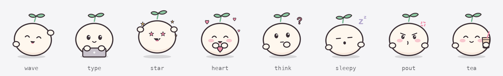

# Hebiu

A personal agent that lives on your Mac desktop. It's a small animated character that keeps you company while you code, remembers your to-dos and nudges you on time. Turn on the optional "AI brain" and it understands plain language and slowly learns about you. Its look, name, personality and every animation are swappable.



<sub>The default character, Biu, is drawn entirely in code. Make your own: [docs/CHARACTERS.md](docs/CHARACTERS.md) (Chinese). 中文说明：[README.md](README.md)</sub>

> The UI and natural-language date parsing are in Chinese for now. Translations are welcome.

## What it does

- **Claude Code / Codex companion**: types while the AI works, calls you when it needs approval, celebrates when a task finishes, looks dizzy on errors. It tracks several sessions at once.
- **To-dos and reminders**: add a to-do in one sentence (`明天下午三点 交周报` = "tomorrow 3pm, weekly report"), get called when it's due. Also habits, important dates (lunar calendar supported), a Pomodoro timer, quick notes, mood log and a weekly review.
- **AI brain (optional)**: bring your own DeepSeek API key. Chat with it, let it add or reschedule to-dos. It writes a diary every night and builds a profile of you, which you can view and edit.
- **Fully skinnable**: images, name, pronoun, persona, lines and the action table all live in one character pack. Actions can be edited right in the main window.
- **Quiet and local**: native Swift, about 15 MB of memory and under 1% CPU. No network by default. All data is plain text in `~/.hebiu/`.

## Install

Requires macOS 13+ and the Xcode command line tools (`xcode-select --install`).

```bash
git clone https://github.com/NouKinSG/hebiu.git
cd hebiu
make install          # build, install to ~/Applications, enable launch at login, start
make hooks            # optional: hook into Claude Code and/or Codex, whichever is installed (appends hooks tagged #hebiu, backs up first)
```

To use your own bundle identifier (used for the keychain item and the login item), create `local.mk` in the repo root:

```make
BUNDLE_ID = com.yourname.hebiu
```

Codex asks once whether to trust the new hooks; choose trust. Codex has no tool-failure hook, so the "error" animation only follows Claude Code.

## Make your own character

Copy `Resources/characters/default` to `~/.hebiu/characters/<name>`, replace the images in `frames/`, edit `character.json`, then pick it in Settings → 形象 (Character). The format is described in [docs/CHARACTERS.md](docs/CHARACTERS.md); the source for Biu is in [art/biu](art/biu).

## Privacy

- No network access by default. Weather sends only the city name to Open-Meteo. With the AI brain on, your messages, the persona and the titles and times of to-dos you added yourself go to your own DeepSeek account.
- The API key is stored in the macOS keychain, never in a file.
- Hebiu reads no account credentials and never approves Claude Code / Codex permission requests for you. Calendar, Reminders and GitLab sources are off by default and are not sent to the AI unless you allow it separately.

## Develop

```bash
make test        # unit tests (never touch ~/.hebiu)
make install-dev # quick reinstall after code changes
make help        # all commands
```

Architecture notes: [docs/ARCHITECTURE.md](docs/ARCHITECTURE.md) (Chinese).

## License

[MIT](LICENSE), including the bundled Biu character. If you share a character you made, make sure you have the right to publish its images.
