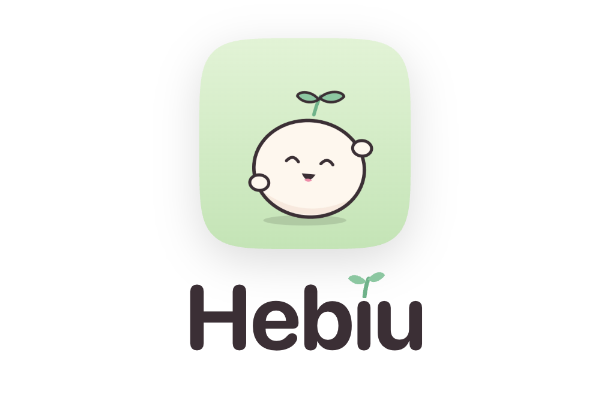
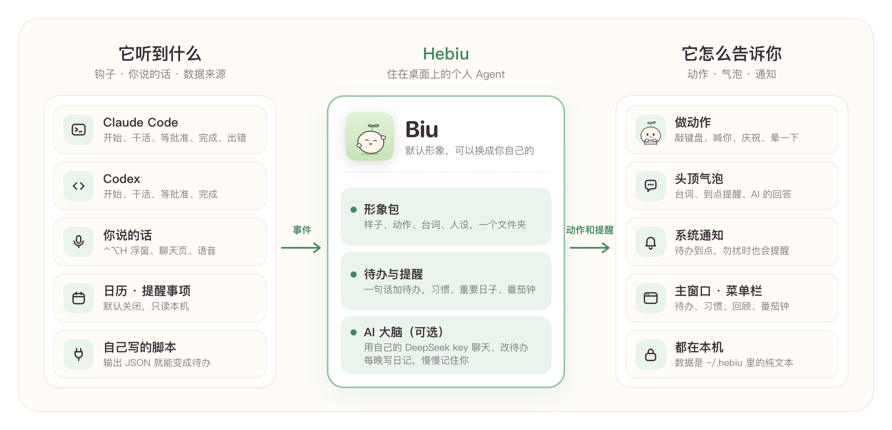

<div align="center">

<picture>
  <source media="(prefers-color-scheme: dark)" srcset="docs/images/logo-dark.png">
  
</picture>

### 住在 Mac 桌面上的个人 Agent

陪你写代码 · 帮你记事 · 到点叫你 · 形象随你换

[](https://github.com/NouKinSG/hebiu/actions/workflows/test.yml) [](LICENSE) [](#快速开始) [](Package.swift) [](#和-claude-code--codex-一起用)

[快速开始](#快速开始) · [使用说明](docs/USAGE.md) · [做自己的形象](docs/CHARACTERS.md) · [常见问题](#常见问题) · [参与贡献](CONTRIBUTING.md)

</div>

**中文** | [English](README.en.md)

Hebiu 是一个住在屏幕角落的小角色。你用 Claude Code 或 Codex 写代码时，它跟着敲键盘、等你批准时喊你、做完了替你高兴；平时帮你记待办、到点叫你、提醒你休息。打开「AI 大脑」后，它能听懂大白话，每晚写日记，慢慢记住你。长什么样、叫什么、什么性格、每件事做什么动作，全都可以换成你自己的。

**原生 Swift · 默认不联网 · 数据都是本机纯文本 · MIT 开源**

<p align="center">
  
</p>

## 它能做什么

| | |
|:---:|---|
|  | **陪你写代码**<br>Claude Code、Codex 干活时它敲键盘，要你批准时喊你，做完了庆祝，出错了晕一下。好几个会话一起开也分得清，后台那个做完了会小声告诉你。 |
|  | **一句话记事，到点叫你**<br>「明天下午三点交周报」「每周五 5 点」「每年 3 月 8 日买花」，时间自动认出来；到点它跳出来喊你。还有习惯打卡、重要日子（支持农历）、番茄钟、随手记、心情、每周回顾。 |
|  | **AI 大脑（可选）**<br>接你自己的 DeepSeek key：和它聊天，让它帮你加待办、改时间、打勾；每晚写一篇日记，记下对你的了解，你可以看、可以改、可以删。 |
|  | **形象随你换**<br>图片、名字、称呼、人设、台词、动作表都在一个形象包里。主窗口「动作」页能直接改每个动作怎么演，不用写代码。 |
|  | **安静，不打扰**<br>可以只在选中的 App（比如终端）里出现，或者平时藏起来、有事才出来；你不动电脑它就睡觉，安静时段自动勿扰。常驻约 15 MB 内存，CPU 1% 以内。 |
|  | **都在本机**<br>默认不联网，数据是 `~/.hebiu/` 里的纯文本，能直接看、直接改、直接备份；key 存在系统钥匙串里。 |

## 快速开始

需要 macOS 13 以上，和 Xcode 命令行工具（`xcode-select --install`）。

```bash
git clone https://github.com/NouKinSG/hebiu.git
cd hebiu
make install          # 编译、装到 ~/Applications、开机自启、启动
```

装好后它就出现在屏幕右下角了，点它、拖它、按住它看看。接下来按需要：

| 想要 | 做什么 |
|---|---|
| 跟着 Claude Code / Codex 动 | `make hooks`，然后新开一个会话（Codex 第一次会问要不要信任新钩子，选信任） |
| 和它聊天、让它记住你 | 主窗口「连接 → AI 大脑」粘贴 DeepSeek key，打开开关；之后按 ⌃⌥H 跟它说话 |
| 换成别的样子 | 「设置 → 形象」，或者[做一个自己的](docs/CHARACTERS.md) |
| 只在终端里出现 | 「设置 → 在哪显示」选「只在选中的 App」 |

全部功能和命令见[使用说明](docs/USAGE.md)。

## 和 Claude Code / Codex 一起用

`make hooks` 给装了的那个（或两个都）追加几条钩子，命令都带 `#hebiu` 标记，改之前先备份。钩子只往 `~/.hebiu/events` 追加一行、不输出任何东西、永远返回成功，Hebiu 没开着也不会让它们报错或变慢。

| 发生了什么 | Claude Code | Codex | 它做什么 |
|---|---|---|---|
| 打开会话 | SessionStart | SessionStart | 打招呼 |
| 你发了消息 | UserPromptSubmit | UserPromptSubmit | 敲键盘，直到下一件事 |
| 要你批准 | Notification | PermissionRequest | 跳出来喊你 |
| 做完了 | Stop | Stop | 庆祝 |
| 出错了 | PostToolUseFailure / StopFailure | — | 晕一下 |

## 表情

<p align="center"></p>

默认形象 Biu 一共 27 帧，全部用代码画的（[art/biu](art/biu)），可以随便改、随便用。

## 做一个自己的形象

```bash
cp -r Resources/characters/default ~/.hebiu/characters/mine
```

把 `frames/` 里的图换成你的（文件名不变就不用改动作表），改 `character.json` 里的名字、称呼、人设和台词，然后在「设置 → 形象」里选 `mine`。格式说明和每个动作什么时候触发，见 [docs/CHARACTERS.md](docs/CHARACTERS.md)。

做好了想分享，欢迎提 PR 放进 `Resources/characters/`。

## 常见问题

<details>
<summary><b>只能在 Mac 上用吗？</b></summary>

是的，界面用的是 AppKit / SwiftUI，需要 macOS 13 以上（Apple 芯片和 Intel 都可以）。形象包、配置文件、钩子格式都是通用的，以后做别的平台可以沿用。
</details>

<details>
<summary><b>要花钱吗？</b></summary>

Hebiu 本身免费。只有打开「AI 大脑」时会用到你自己的 DeepSeek 账号，按官方价格计费，日常聊天大约每月几块钱；默认每月上限 30 元，到了自动停，可以在设置里改。
</details>

<details>
<summary><b>不用 Claude Code / Codex 也能用吗？</b></summary>

能。待办、提醒、习惯、番茄钟、AI 大脑这些都不依赖它们，钩子不装就行。
</details>

<details>
<summary><b>会拖慢 Claude Code / Codex 吗？</b></summary>

不会。每条钩子只往本地文件追加一行，不等 Hebiu 回应，也不替你批准任何权限请求。
</details>

<details>
<summary><b>会把我的东西发出去吗？</b></summary>

默认不联网。打开天气只发城市名给 Open-Meteo；打开 AI 大脑后，你说的话、人设、你自己加的待办标题和时间会发给你自己的 DeepSeek 账号。日历、提醒事项、GitLab 等来源默认关，打开了也不发给 AI，除非你单独允许。
</details>

<details>
<summary><b>怎么备份、换电脑、卸载？</b></summary>

`make backup` 把数据打包到桌面，新电脑上 `make restore FILE=备份文件`，详见[换电脑](docs/NEW_MACHINE.md)。卸载用 `make uninstall`（保留 `~/.hebiu`），`scripts/uninstall.sh --purge` 连数据一起删。
</details>

## 参与贡献

欢迎提 issue 和 PR：新功能、新形象、修 bug、翻译都行。开发方法和几条约定见 [CONTRIBUTING.md](CONTRIBUTING.md)，代码结构见[架构说明](docs/ARCHITECTURE.md)。

## 许可

[MIT](LICENSE)。自带的形象 Biu 一起按 MIT 发布；分享自己做的形象时，请确认图片你有权公开。
