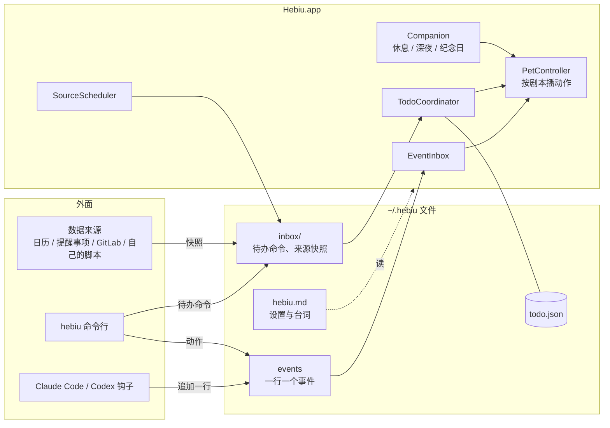
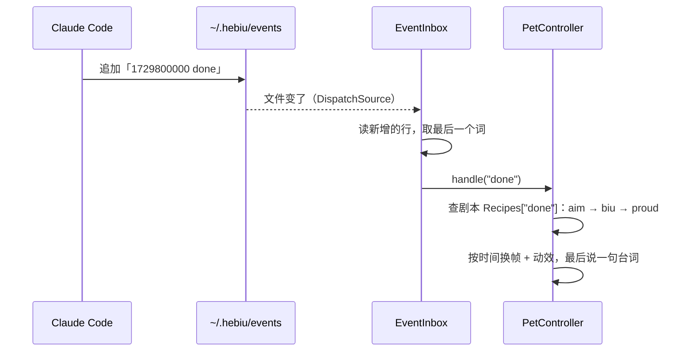
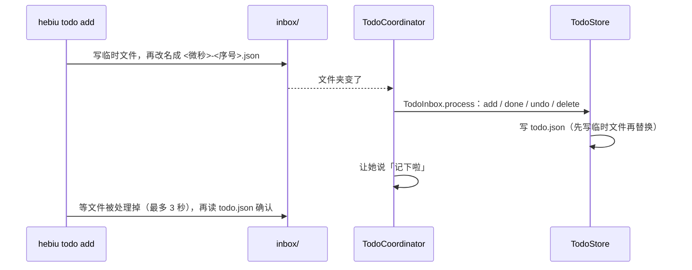

# 架构

## 一张图看懂

三条规矩，所有设计都从这里来：

1. **默认不联网**。要外面的数据，由独立的来源（脚本或系统接口）拿，交到收件箱。唯一的例外是 AI 大脑：默认关闭，打开后只把你说的话、人设和你自己加的待办发给你的 DeepSeek 账号。
2. **一个文件只有一个写入者**。`todo.json` 只有桌宠自己写；命令行、来源都通过 `inbox/` 交给它。两个进程同时写坏文件的事不会发生。
3. **出错不连累别人**。钩子永远返回成功；来源失败时什么都不写，已有待办不动；配置写坏了用默认值。

## 模块

| 模块 | 位置 | 做什么 |
|---|---|---|
| Paths / Log | `HebiuKit/Paths.swift` | 数据目录（可用 `HEBIU_HOME` 换掉，测试用）、日志 |
| Config | `HebiuKit/Config.swift` | 读写 `hebiu.md`：设置、纪念日、来源开关、台词；旧文件缺的小节自动补上 |
| FileWatcher / DirectoryWatcher / EventInbox | `HebiuKit/FileWatcher.swift` | 文件和文件夹变化通知；事件文件逐行读新内容 |
| Companion | `HebiuKit/Companion.swift` | 休息、深夜、纪念日、生日 |
| TodoItem / TodoStore | `HebiuKit/Todo/` | 待办的数据结构、存储（原子写、每天备份、坏文件挪开）、来源对账 |
| TimeParser / TodoFormat | `HebiuKit/Todo/TimeParser.swift` | 从一句中文里认出时间；时间的显示文字 |
| TodoQuery | `HebiuKit/Todo/TodoQuery.swift` | 分组（今天 / 以后 / 已完成）、排序、是否过期 |
| TodoInbox | `HebiuKit/Todo/TodoInbox.swift` | 处理 `inbox/` 里的命令和来源快照 |
| ReminderPlanner / ReminderState | `HebiuKit/Todo/ReminderPlanner.swift` | 该不该提醒、说什么（纯规则，全部有测试） |
| ScriptSource / SourceCatalog | `HebiuKit/Sources/` | 运行来源脚本（超时、补 PATH、解析输出）；已知来源清单 |
| PetController / Recipes | `Hebiu/` | 动作剧本、换帧、动效、空闲小动作、提醒气泡 |
| PetWindow | `Hebiu/PetWindow.swift` | 透明置顶窗口、点击穿透、拖动、气泡 |
| TodoCoordinator | `Hebiu/TodoCoordinator.swift` | 桌宠这边的待办总管：监听收件箱、定时检查提醒、让她说话 |
| SourceScheduler | `Hebiu/SourceScheduler.swift` | 定时跑打开的来源；日历和提醒事项（EventKit） |
| MainWindow 及各页面 | `Hebiu/UI/` | 主窗口（侧边栏分组 + 页面）：主页、待办、动作、台词、我们、数据来源、Claude / Codex、设置（SwiftUI）；`Theme.swift` 是统一的页面框架、卡片、颜色 |
| Notifier | `Hebiu/Notifier.swift` | 系统通知 |
| CLI | `Hebiu/CLI.swift` | 带参数运行时的命令行 |
| AgentSecrets / AgentPrivacy | `HebiuKit/Agent/` | DeepSeek key 存钥匙串（经 `security` 命令读写，重新编译不弹授权）；发出去之前过滤待办 |
| AgentLedger / AgentPricing | `HebiuKit/Agent/AgentLedger.swift` | 按官方价格（高峰 / 空闲、缓存命中）逐笔记账，月度上限 |
| AgentTools | `HebiuKit/Agent/AgentTools.swift` | 给模型的工具：查、加、打勾、改时间、表情，打开记忆时多记住、翻日记；只认见过的 id，改动可撤销 |
| DeepSeekClient / AgentSession / AgentChatLog | `HebiuKit/Agent/` | 拼提示词、和 DeepSeek 来回（最多 4 次）、失败处理、对话记录 |
| RepeatRule | `HebiuKit/Todo/RepeatRule.swift` | 重复规则（每天、工作日、每周几、每月、每年），从一句话里认出来，算下一次 |
| ImportantDates / Habits / Moods / Notes | `HebiuKit/` | 重要日子（含农历）、习惯打卡、心情、随手记；各一个 json，只有桌宠写 |
| WeekReview | `HebiuKit/WeekReview.swift` | 把一周的统计、写代码时间、习惯、心情、完成的待办凑到一起 |
| WeatherClient / QuietHours | `HebiuKit/` | Open-Meteo 天气（只发城市名，一小时缓存）；安静时段 |
| ScheduledTasks | `HebiuKit/Agent/ScheduledTasks.swift` | 定时让她做的事，到点由 AI 去做 |
| Stats | `HebiuKit/Stats.swift` | 小统计，按天计数（凌晨 4 点换天），`~/.hebiu/stats.json` |
| FocusSession | `HebiuKit/Focus.swift` | 番茄钟的时间状态：专心 → 休息 → 空闲 |
| PhotoAlbum / PhotoPopup | `HebiuKit/PhotoAlbum.swift`、`Hebiu/PhotoPopup.swift` | 从选的文件夹随机挑合照，拍立得样子弹在她旁边 |
| VoiceInput | `Hebiu/Agent/VoiceInput.swift` | 系统中文语音识别，支持时只在本机识别 |
| AgentMemory / AgentMemoryWriter | `HebiuKit/Agent/` | 记忆：了解、日记、周记、月记都是 md 文件；每晚整理、补整理、翻日记；提示词只带固定大小的一段 |
| AgentController / ChatPanel / GlobalHotkey | `Hebiu/Agent/` | 桌宠这边：浮窗、全局快捷键、让她回答时做表情 |

`HebiuKit` 不依赖界面，能测的逻辑都放这里；`Hebiu` 只管显示和接线。

## 一个事件怎么变成动作

剧本是数据（`Recipes.swift`）：先依次播 `steps`，再停在 `hold` 上，`holdSeconds` 后回到站岗；`loop` 不为空就循环（敲键盘）。每次换剧本「代号」加一，旧剧本里没到点的任务发现代号不对就跳过，不用维护任务列表。

## 待办的一条命令怎么走

来源快照（`inbox/sources/<来源>.json`）每次整份覆盖，`TodoStore.reconcile` 对账：新的加进来、变了的更新、来源里没了而且还没完成的删掉；已完成的不会因为来源里还有就复活。

## 提醒

`TodoCoordinator` 每 20 秒问一次 `ReminderPlanner`，一次只说一件事，优先级：

1. 到点的待办（勿扰也提醒）：她停在「怼脸」上，气泡一直挂着，别的自动事件只换动作不换台词，点她才收起
2. 早上汇总：今天第一次在用电脑（最近 2 分钟动过键盘鼠标，6 点以后）
3. 下班提醒：过了设定时间、今天还有没做完的

早上 / 下班说过没有记在 `state.json`，重启不会重复。

## 文件格式

| 文件 | 格式 | 兼容性 |
|---|---|---|
| `hebiu.md` | Markdown：`## 小节`、`- key: value`、`### 事件` 下一行一句台词 | 写错的行忽略、缺的值用默认 |
| `todo.json` | `{"version": 1, "items": [...]}` | 缺字段给默认值；读不了就挪成 `todo.broken-时间.json`，不覆盖 |
| `inbox/*.json` | `{"op": "add", "text": "…"}` 等 | 看不懂的挪到 `inbox/bad/` |
| `inbox/sources/*.json` | `{"source": "…", "items": [...]}` | 同上 |
| `state.json` | `{"morningDay": "2026-10-25", …}` | 读不了当没说过 |

改 `todo.json` 格式时：`TodoStore.schemaVersion` 加一，`TodoItem.init(from:)` 里给新字段默认值，旧文件照样能读。

## 扩展点

| 想加 | 改哪里 |
|---|---|
| 新动作、新形象 | 都在形象包里，不用改代码，见 [CHARACTERS.md](CHARACTERS.md) |
| 新台词事件 | `Config.defaultLines` + `Config.lineOrder` + 设置页 `lineEvents` |
| 新设置项 | `Config.Settings` 加字段 → `load()` 解析 → `render()` 写回 → 设置页 |
| 新提醒规则 | `ReminderPlanner` 加一个纯函数 + 测试 → `TodoCoordinator.checkReminders` 调用 |
| 新数据来源 | 写脚本放 `datasources/`（安装时装进 `~/.hebiu/sources/`，见 [SOURCES.md](SOURCES.md)）；要系统权限的才在 `SourceScheduler` 里内置 |
| 新页面 | `MainPage` 加一个 case 并归到 `sidebar` 某个分组，页面用 `Page` + `Card` 写；菜单不加项 |
| 新命令 | `CLI.swift`，改待办的一律走 `TodoInbox.post` |

## 测试

`make test` 跑 `HebiuKitTests`（Swift Testing），每个测试用临时目录，不碰 `~/.hebiu`。时间相关的测试都固定「现在」为 2026-10-23 周五 14:30。

界面部分没有自动化测试；改完 `make install-dev` 实际点一遍。

## 性能

- 空闲时只有几个低频定时器：换帧 0.5 秒、鼠标位置 0.1 秒、提醒 20 秒、来源 60 秒
- 呼吸动画交给 Core Animation，在系统渲染进程里跑
- 图片启动时按显示尺寸缩放一次；点击判定用 96×96 的透明度图
- 实测：空闲约 20 MB 内存、CPU 1% 以内
